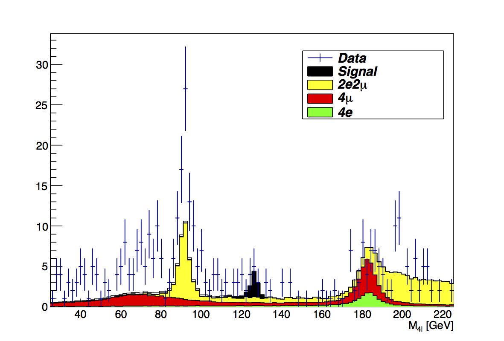
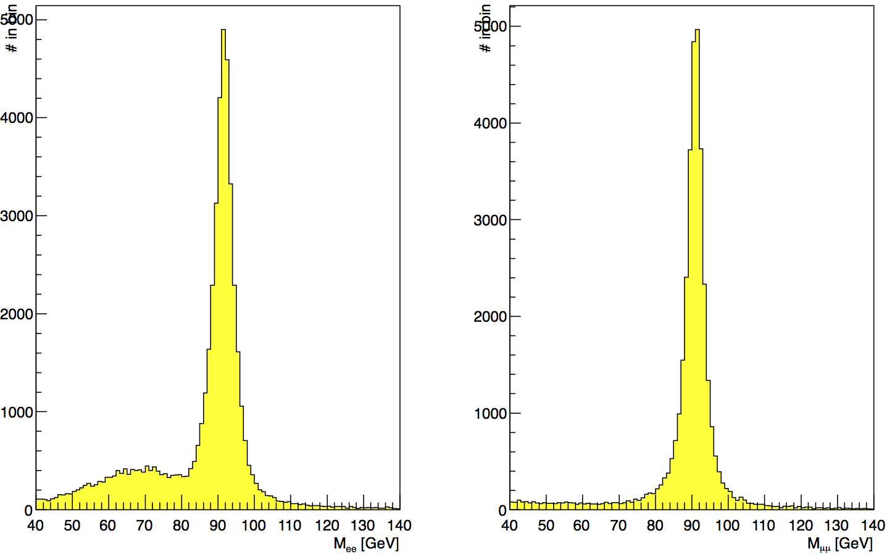
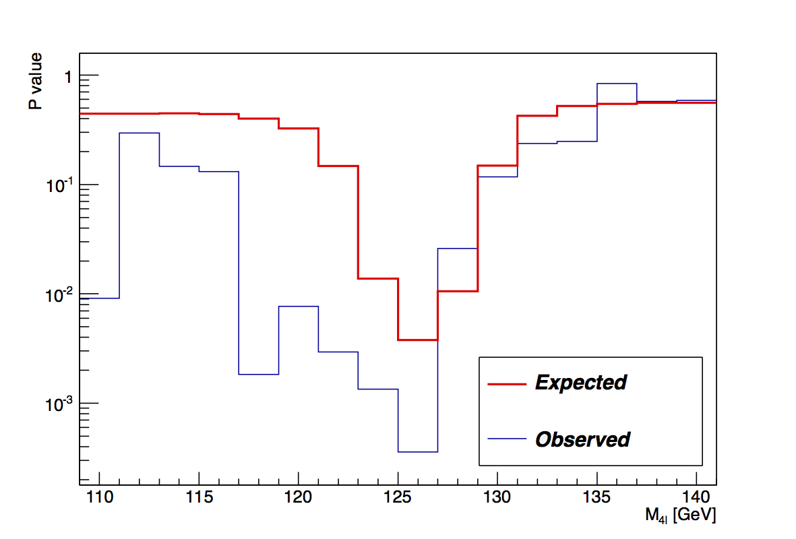
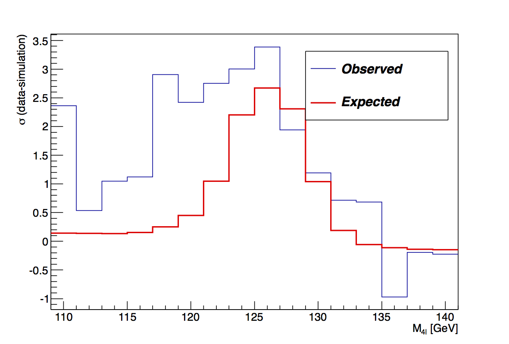

# VUB Higgs search (H → ZZ → 4l)

A search for the Higgs boson through its decay to two Z bosons and then four leptons, using the 19.6 fb⁻¹ of proton-proton collisions at √s = 8 TeV that the CMS detector at CERN recorded in 2012. It was my physics bachelor thesis in spring 2014 at the Vrije Universiteit Brussel (VUB), carried out at the Inter-University Institute for High Energies (IIHE). The analysis is a set of ROOT macros in C++, and the thesis is written in LaTeX.

The thesis itself is [thesis/BachelorProef.pdf](thesis/BachelorProef.pdf).



## What it does

- **Reconstructs Z bosons.** A Z boson decays to an electron or muon pair, and the invariant mass of that pair peaks at 91 GeV.
- **Builds the four-lepton mass distribution** in the 4e, 2e2μ and 4μ channels from simulations of ZZ production. Events where a Z decays to two taus that then decay to electrons or muons are included through the tau branching ratios.
- **Normalises the simulation** to the data using cross sections, the integrated luminosity and the number of generated events, then corrects it with a fit to the data/simulation ratio in the control region.
- **Blinds the signal region.** Data between 110 and 140 GeV stays hidden until the background is understood.
- **Adds the Higgs signal** from simulations of gluon fusion and vector boson fusion with a Higgs mass of 126 GeV, then unblinds the data.
- **Tests the excess.** In 2 GeV steps between 109 and 141 GeV, it compares the expected background with the data (observed) and with background plus signal (expected), giving a p-value and a significance (z score) at each mass.
- **Tries extra cuts** on lepton transverse momentum and on the two Z masses. These did not improve the significance, so they were not applied.

The thesis reports an excess at 126 GeV with an observed p-value of 0.00036, or 3.4σ, against 2.7σ expected: evidence, but short of the 5σ needed for a discovery.



| P value | z score |
|---|---|
|  |  |

## How it works

- `analysis/Bachelorproef.C` is the main ROOT macro. `Run()` makes the mass distributions, Z peaks, ratio plots and significance plots in the thesis. `Bachelorproef(...)` draws one canvas, and its flags choose the normalisation, blinding, data, signal, channels, ratio plot and cuts. `Signal()`, `ZPeak()` and `RatioPlots()` make the supporting plots.
- `InvariantZMassCalculator` and `InvariantZZMassCalculator` are ROOT `MakeClass` readers for the ntuple tree. Their `Loop` keeps isolated leptons (particle-flow isolation below 0.05), requires zero total charge, and fills a histogram of the Z mass or the four-lepton mass, weighted for pile-up.
- The significance test uses RooStats' `NumberCountingUtils`. That part of `Bachelorproef()` was supplied by the promoter.
- `calculations/BranchingRatiosZZDecay.m` is a short Mathematica script that combines the Z and tau branching ratios for every route from ZZ to four electrons or muons.

| Path | What it is |
|---|---|
| `thesis/BachelorProef.pdf` | The thesis as submitted |
| `thesis/BachelorProef.tex`, `thesis/figures/`, `thesis/titelpage.pdf` | Its LaTeX source |
| `analysis/` | The ROOT macros |
| `calculations/` | The branching ratio calculation |

## Running it

The macros were written for ROOT 5.34 with RooFit and RooStats, and have not been tried with ROOT 6. They read flat ROOT ntuples (a TTree called `tree` with the electrons and muons of each event) made from CMS data and simulation for this project. These ntuples are not part of this repository. The CMS data was not public in 2014. CMS has since released its 2012 data and simulations on the [CERN Open Data Portal](https://opendata.cern.ch), but in a different format, so running the macros on it would need a new reader.

With the ntuples in place, the macros expect this layout:

```
analysis/
├── Simulations/   ZZTo4e_8TeV_tree.root, ZZTo4mu_8TeV_tree.root, ZZTo4tau_8TeV_tree.root,
│                  ZZTo2e2mu_8TeV_tree.root, ZZTo2e2tau_8TeV_tree.root, ZZTo2mu2tau_8TeV_tree.root,
│                  GluGluToHToZZTo4L_M-126_8TeV_tree.root, HToZZTo4L_M-126_8TeV_tree.root
├── Data/          Data*.root
├── Figures/       output
└── Debugging/     output
```

Then, from `analysis/`:

```
root -l
root [0] .L Bachelorproef.C
root [1] Run()
```

## License

BSD 3-Clause, see [LICENSE](LICENSE). The license covers the code in `analysis/` and `calculations/`. The thesis text is © 2014 Jeremy Lombaerts. Figures taken from other sources are listed with their origin in the thesis's list of figures and are not covered by this license. The CMS data and simulations belong to the CMS Collaboration.
